# SITTA — Sistem Informasi Tiras & Transaksi Bahan Ajar

Aplikasi web sederhana untuk pemesanan dan pemantauan **Bahan Ajar Universitas Terbuka** oleh UT-Daerah.
Tugas Praktik 1 — Pemrograman Berbasis Web.

Aplikasi ini **front-end only**: tidak memakai back-end/database. Semua data dibaca dari file
`js/data.js`, dan data tambahan (akun baru, bahan ajar baru) disimpan di `localStorage` browser.
Tampilan mengikuti gaya **Ant Design** (warna, tombol, form, tabel, modal, notifikasi) dan
mendukung **tampilan mobile**.

🌐 **Demo online:** <https://sitta-ut-yosada.netlify.app/>
(login dengan `rina@ut.ac.id` / `rina123`)

## Identitas Mahasiswa

| | |
| --- | --- |
| **Nama** | Yosada Dede Aressa |
| **NIM** | 052984188 |
| **Program Studi** | Sistem Informasi |
| **UT Daerah** | UT Surakarta |

---

## Daftar Isi

1. [Cara Menjalankan](#cara-menjalankan)
2. [Akun & Data Uji](#akun--data-uji)
3. [Struktur Folder](#struktur-folder)
4. [Screenshot Tiap Halaman](#screenshot-tiap-halaman)
5. [Fitur per Kriteria Penilaian](#fitur-per-kriteria-penilaian)
6. [Catatan Teknis](#catatan-teknis)

---

## Cara Menjalankan

Tidak perlu instalasi apa pun. Pilih salah satu cara:

**Cara 1 — Buka versi online (tanpa unduh)**

Kunjungi <https://sitta-ut-yosada.netlify.app/> lalu login dengan akun demo di bawah.

**Cara 2 — Buka file langsung**

1. Buka folder proyek `Tugas1/`.
2. Klik dua kali file `index.html` (akan terbuka di browser).
3. Login dengan akun demo di bawah.

**Cara 3 — VS Code Live Server**

1. Buka folder proyek `Tugas1/` di VS Code.
2. Install ekstensi **Live Server** (Ritwick Dey).
3. Klik kanan `index.html` → **Open with Live Server**.

**Cara 4 — Server lokal via terminal**

```bash
cd Tugas1
python3 -m http.server 8000
# lalu buka http://localhost:8000
```

> Browser yang disarankan: Chrome, Edge, Firefox, atau Safari versi terbaru
> (aplikasi memakai elemen `<dialog>` untuk modal).
>
> Ikon memakai **Bootstrap Icons** dari CDN, jadi butuh koneksi internet agar ikon tampil.
> Tanpa internet aplikasi tetap berjalan normal, hanya ikonnya yang tidak muncul.

---

## Akun & Data Uji

Akun diambil dari variabel `dataPengguna` di `js/data.js`:

| Nama           | Email            | Password   | Role          |
| -------------- | ---------------- | ---------- | ------------- |
| Rina Wulandari | `rina@ut.ac.id`  | `rina123`  | UPBJJ-UT      |
| Agus Pranoto   | `agus@ut.ac.id`  | `agus123`  | UPBJJ-UT      |
| Siti Marlina   | `siti@ut.ac.id`  | `siti123`  | Puslaba       |
| Doni Setiawan  | `doni@ut.ac.id`  | `doni123`  | Fakultas      |
| Admin SITTA    | `admin@ut.ac.id` | `admin123` | Administrator |

Nomor Delivery Order (DO) untuk uji halaman Tracking:

| Nomor DO     | Mahasiswa      | Kondisi                         |
| ------------ | -------------- | ------------------------------- |
| `2023001234` | Rina Wulandari | Dalam perjalanan (progress 50%) |
| `2023005678` | Agus Pranoto   | Sudah diterima (progress 100%)  |
| `1111111111` | —              | Contoh nomor tidak ditemukan    |

---

## Struktur Folder

```
Tugas1/
├── index.html          → Halaman Login (+ modal Lupa Password & Daftar)
├── dashboard.html      → Dashboard / menu utama, Laporan, dan Histori Transaksi
├── tracking.html       → Tracking pengiriman berdasarkan Nomor DO
├── stok.html           → Informasi stok bahan ajar
├── css/
│   └── style.css       → Seluruh tampilan (design system ala Ant Design + responsive)
├── js/
│   ├── data.js         → Data dummy: dataPengguna, dataBahanAjar, dataTracking
│   └── script.js       → Seluruh logika JavaScript (DOM, validasi, modal, dll.)
├── assets/
│   ├── img/            → Gambar sampul bahan ajar
│   └── screenshots/    → Screenshot untuk README ini
├── soal/               → Screenshot soal tugas (soal1.png – soal4.png)
└── README.md           → Dokumentasi (file ini)
```

### Penjelasan tiap file/folder

| File / Folder        | Fungsi |
| -------------------- | ------ |
| `index.html`         | Halaman pertama yang dibuka. Berisi form login (email & password), tombol **Lupa Password** dan **Daftar** yang membuka modal. Jika sudah login, otomatis diarahkan ke dashboard. |
| `dashboard.html`     | Menu utama setelah login. Menampilkan salam sesuai waktu (pagi/siang/sore/malam), ringkasan statistik, dan tombol navigasi. Halaman ini juga memuat 3 tampilan laporan yang dibuka lewat alamat `#monitoring`, `#rekap`, dan `#histori`. |
| `tracking.html`      | Form input Nomor DO. Setelah tombol **Cari** ditekan, tampil nama mahasiswa, status & tahapan pengiriman (progress bar), detail ekspedisi, tanggal kirim, jenis paket, total pembayaran, dan riwayat perjalanan. |
| `stok.html`          | Daftar bahan ajar yang dibangun dinamis dari `dataBahanAjar`. Ada pencarian, filter, pengurutan, detail, serta form tambah bahan ajar. |
| `css/style.css`      | Satu file CSS untuk semua halaman. Berisi *design token* (warna, radius, bayangan), komponen (Button, Input, Card, Table, Tag, Modal, Steps, Timeline, dll.), layout, dan aturan responsive. |
| `js/data.js`         | Data dummy pengganti database. Dimuat sebelum `script.js`. |
| `js/script.js`       | Satu file JS untuk semua halaman. Halaman aktif dikenali dari atribut `<body data-page="...">`. Isinya dibagi menjadi 10 bagian bernomor: helper umum, penyimpanan & sesi login, komponen UI (notifikasi, pop-up konfirmasi, validasi form), layout, helper data, lalu satu bagian untuk setiap halaman, dan inisialisasi. |
| `assets/img/`        | Sampul buku yang dipakai oleh `dataBahanAjar` (properti `cover`). |
| `assets/screenshots/`| Gambar dokumentasi; tidak dipakai oleh aplikasi. |
| `soal/`              | Screenshot soal Tugas Praktik 1 sebagai acuan: [soal1](soal/soal1.png), [soal2](soal/soal2.png), [soal3](soal/soal3.png), [soal4](soal/soal4.png). Tidak dipakai oleh aplikasi. |

### Alur antar halaman

```
index.html ──(login berhasil)──► dashboard.html ──┬──► stok.html
     ▲                                            ├──► tracking.html
     │                                            ├──► dashboard.html#monitoring
     └────────────(Keluar / logout)───────────────├──► dashboard.html#rekap
                                                  └──► dashboard.html#histori
```

Halaman selain `index.html` **dilindungi**: jika dibuka tanpa login, pengguna otomatis
dikembalikan ke halaman login.

---

## Screenshot Tiap Halaman

### 1. Halaman Login — `index.html`

Tampilan awal: panel informasi di kiri, form login di kanan.

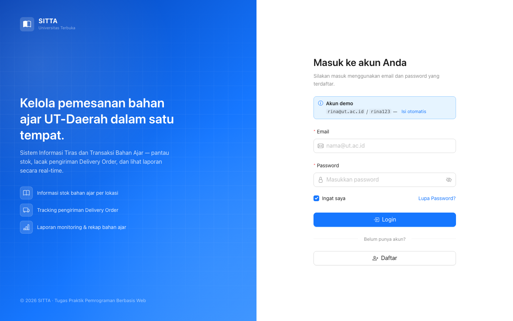

Validasi form — pesan error muncul di bawah setiap kolom yang kosong/salah format:


Pop-up ketika email/password salah:


Modal **Lupa Password**:

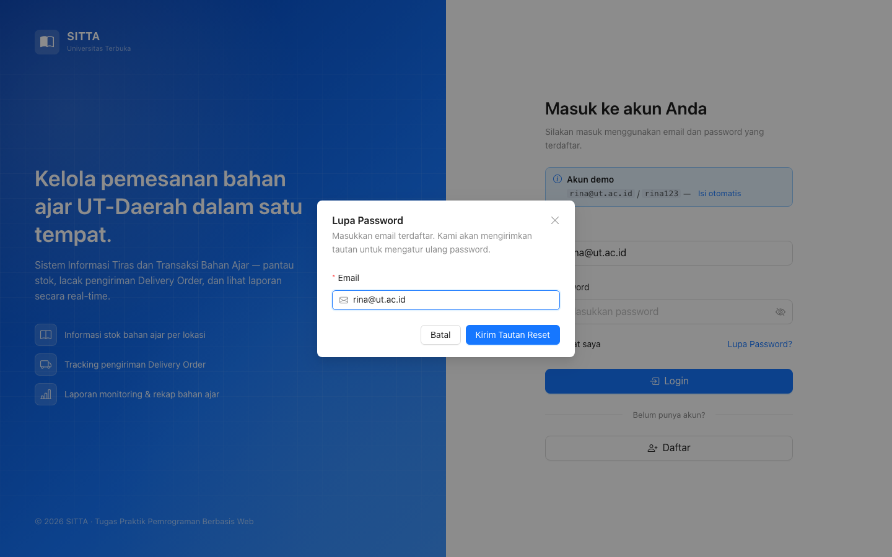

Modal **Daftar** beserta validasinya (wajib isi, format email, minimal 6 karakter, konfirmasi password, persetujuan):


### 2. Dashboard — `dashboard.html`

Salam berdasarkan waktu lokal, jam berjalan, statistik ringkas, menu utama, pengiriman terbaru, dan stok bahan ajar.


### 3. Laporan — Monitoring Progress DO — `dashboard.html#monitoring`

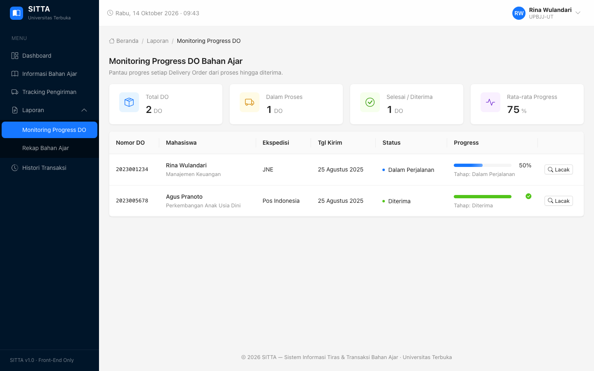

### 4. Laporan — Rekap Bahan Ajar — `dashboard.html#rekap`

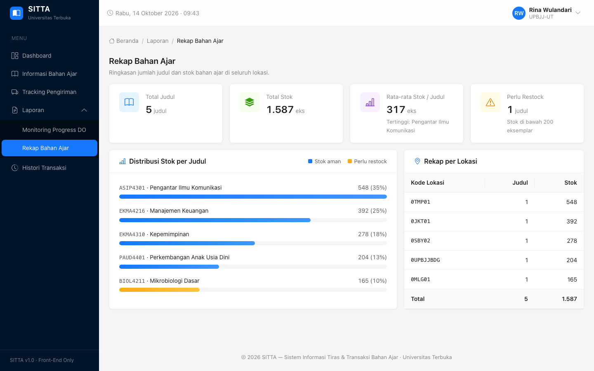

### 5. Histori Transaksi — `dashboard.html#histori`

Bisa dicari dan difilter berdasarkan status, lengkap dengan total pembayaran.

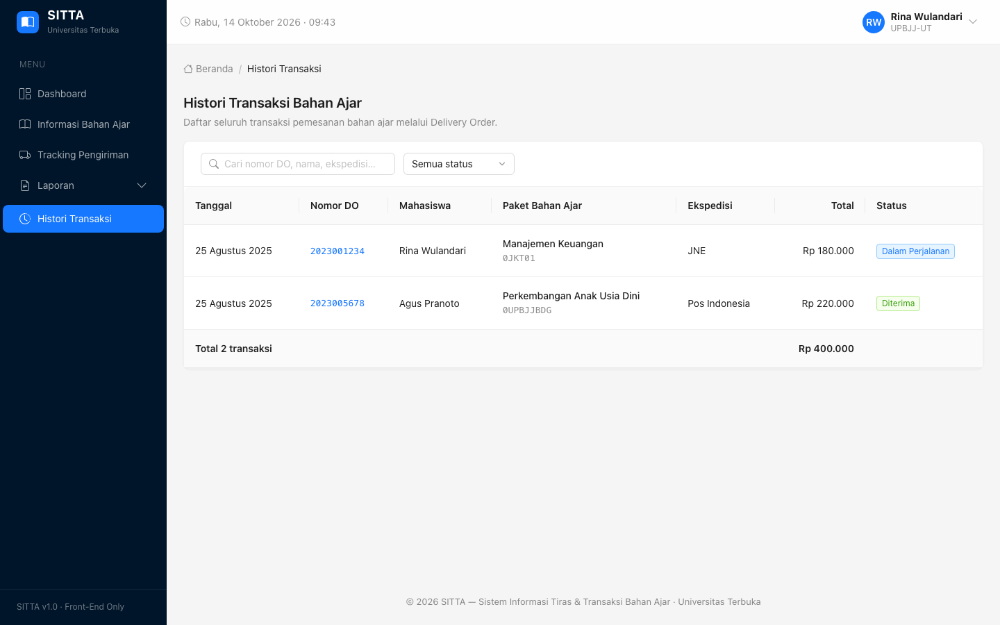

### 6. Tracking Pengiriman — `tracking.html`

Hasil pencarian Nomor DO: tahapan pengiriman, progress bar, detail pengiriman, dan riwayat perjalanan.

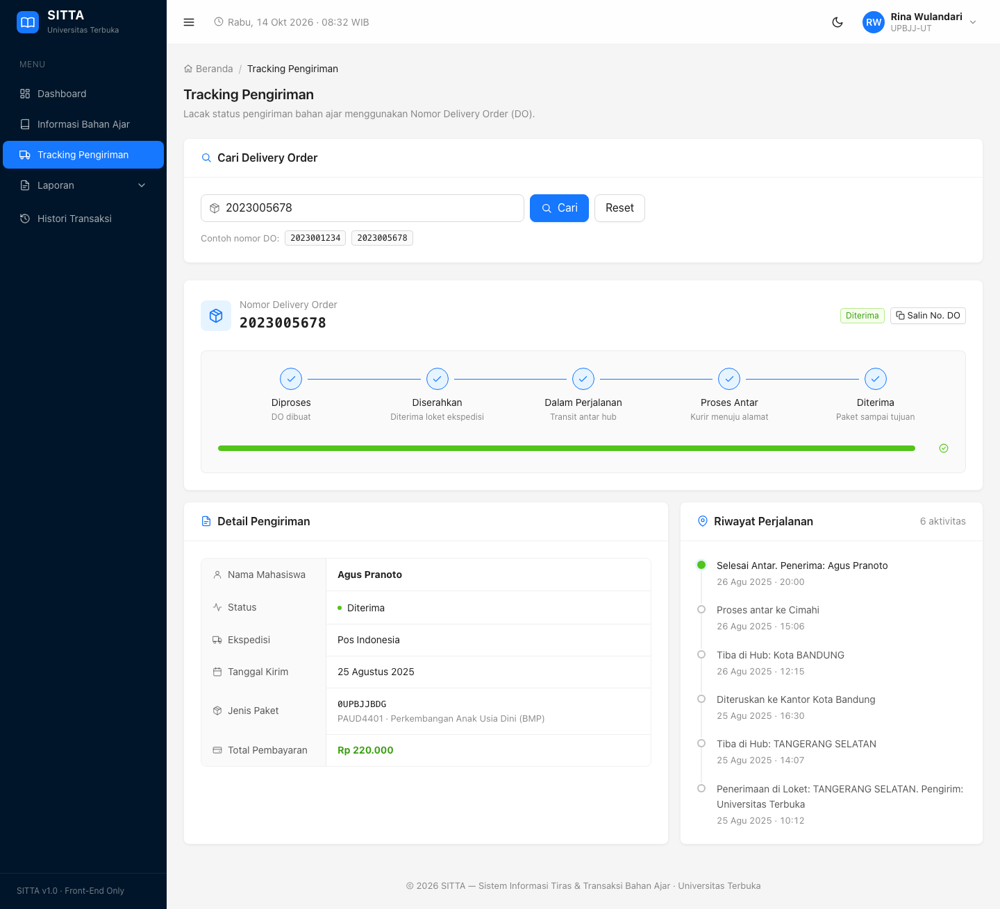

Jika Nomor DO tidak ditemukan:

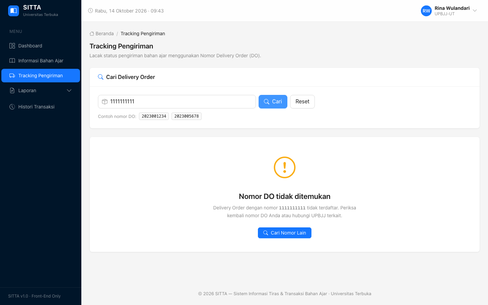

### 7. Informasi Stok Bahan Ajar — `stok.html`

Tampilan tabel (dinamis dari `dataBahanAjar`):


Detail bahan ajar (klik salah satu baris):

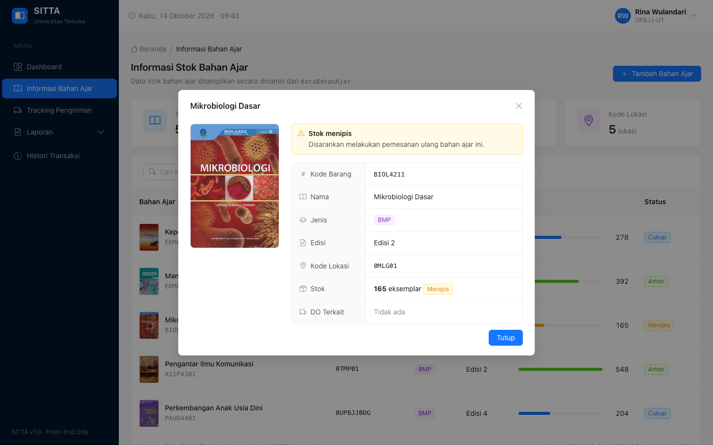

Form **Tambah Bahan Ajar** dengan validasi:

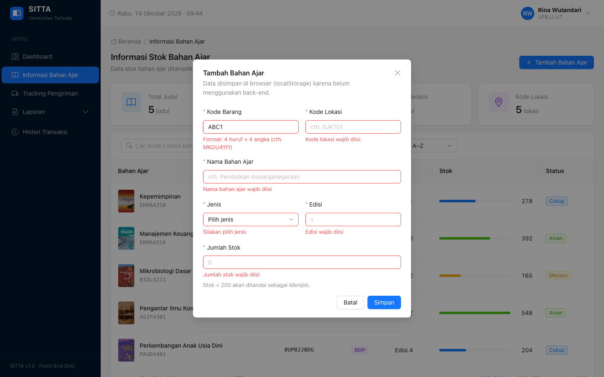

### 8. Tampilan Mobile

| Dashboard | Menu samping |
| --------- | ------------ |
| 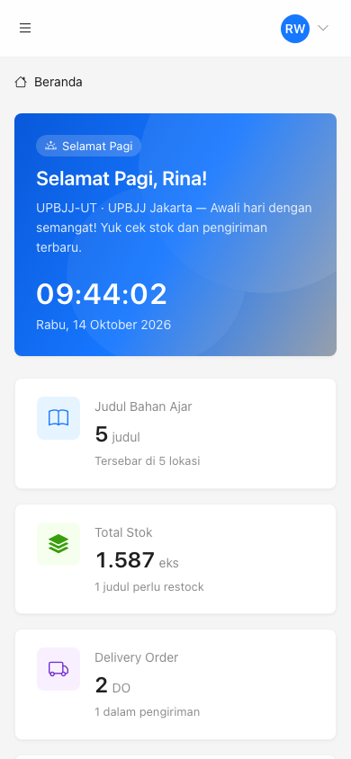 | 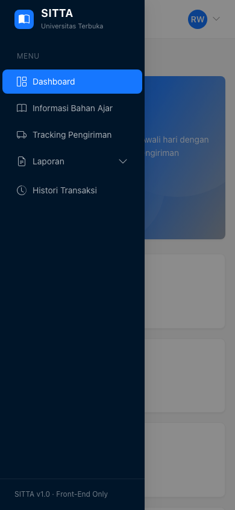 |

---

## Fitur per Kriteria Penilaian

| Kriteria | Implementasi |
| -------- | ------------ |
| **1.1 HTML semantik & valid** | `<!DOCTYPE html>`, `lang="id"`, `<header>`, `<nav>`, `<main>`, `<aside>`, `<section>`, `<article>`, `<footer>`, `<dialog>`, `<dl>` untuk detail, `<table>` dengan `<thead>/<tbody>/<tfoot>` dan `scope`, `<time datetime>`, label untuk setiap input, atribut ARIA, dan *skip link*. |
| **1.2 Desain CSS** | *Design token* dengan CSS variables, komponen seragam ala Ant Design, Flexbox & Grid, dan responsive (desktop → tablet → mobile). |
| **1.3 JavaScript DOM** | Render dinamis tabel, statistik, dan grafik batang dari `data.js`, pencarian & filter langsung, salam & jam real-time, modal, dropdown, menu samping, perpindahan tampilan via `#hash`, serta tambah/hapus data. |
| **1.4 Validasi form & alert** | Validasi langsung saat mengetik (wajib isi, format email, panjang minimal, pola Nomor DO 10 digit, kode barang, angka min/max, konfirmasi password). Pop-up login gagal, konfirmasi logout/hapus, dan notifikasi *toast* sukses/error. |
| **1.5 Modularitas file** | Struktur folder sesuai ketentuan. Satu `style.css` dan satu `script.js` yang dibagi per modul, sementara data terpisah di `data.js`. Sider & header dirender dari satu fungsi agar seragam di semua halaman. |
| **1.6 Kreativitas** | Akun demo "isi otomatis", tahapan pengiriman (Steps) + timeline, tombol salin Nomor DO, tautan langsung `tracking.html?do=...`, tampilan mobile dengan menu samping berbentuk laci. |

---

## Catatan Teknis

- **Perubahan pada `data.js`** dari file yang dilampirkan:
  - Tag `<script>` pembungkus dihapus agar valid sebagai file `.js`.
  - `var` diganti `const` (sesuai soal: *"variable konstanta dataBahanAjar"*).
  - Path sampul disesuaikan ke `assets/img/...`, dan `paud_perkembangan.jpg` → `.jpeg` sesuai nama file aslinya.
  - Typo `nomorDO` pada DO `2023005678` (sebelumnya tertulis `2023001234`) diperbaiki.
- **Status DO** ditentukan dari riwayat perjalanan. Contoh: DO `2023005678` berstatus "Dikirim" di data,
  tetapi riwayat terakhirnya "Selesai Antar", sehingga ditampilkan sebagai **Diterima (100%)**.
- **Penyimpanan browser** (`localStorage`/`sessionStorage`) dipakai untuk: sesi login ("Ingat saya"),
  akun hasil daftar, dan bahan ajar tambahan.
  Untuk mengembalikan ke data awal, hapus *site data* browser atau jalankan `localStorage.clear()` di Console.
- Halaman login bernama `index.html` (bukan `login.html`) mengikuti struktur folder pada soal.
